<!--
  👀 Reading the raw source? Respect.
  🏆 Achievement unlocked: View Source Enjoyer
  Everything on this page is hand-made SVG + plain HTML. No external widgets were harmed.
-->

<p align="center">
  
</p>

<p align="center">
  <a href="#get-about"></a>
  <a href="#get-stack"></a>
  <a href="#get-career"></a>
  <a href="#get-actuatorhealth"></a>
  <a href="#post-play"></a>
</p>

---

### `GET /about`

```http
HTTP/1.1 200 OK
Content-Type: application/json
X-Powered-By: coffee
X-Response-Time: 25 years
```

```json
{
  "name": "Baha Kuzudişli",
  "role": "Full-Stack Software Engineer",
  "company": "HAVELSAN",
  "location": "Ankara, Türkiye 🇹🇷",
  "building": "A large-scale public-sector tax platform",
  "dailyDriver": ["Java", "Spring Boot", "Angular", "PostgreSQL", "Kafka"],
  "currentlyLearning": ["Flutter", "shipping real apps with AI agents"],
  "funFact": "My first commit was an Android app. My latest one probably fixed a NullPointerException."
}
```

---

### `GET /stack`

<p align="center">
  
</p>

---

### `GET /career`

```text
$ git log --graph --oneline career

* a1c0ffe (HEAD -> main, tag: v25.0.0) feat: full-stack engineer @ HAVELSAN
|\
| * f1u77e2 (feature/flutter) wip: building & shipping my own mobile apps
|/
* 7b3e2d4 feat: B.Sc. Computer Engineering @ Ankara Yıldırım Beyazıt University
* 4f9a1c2 feat: Android internships @ Comodo · Innova · Ordulu Teknoloji
* 0000001 init: System.out.println("Hello, World!");
```

---

### `GET /actuator/health`

<p align="center">
  
</p>

---

### `POST /play`

> 🕹️ **Friday Deploy** — a tiny text adventure. Click to play. There are **5 endings**. Can you find them all?

<details>
<summary><b>▶ It's Friday, 17:55.</b> A PR titled <code>fix: small change</code> just got approved…</summary>
<br>
<blockquote>
<p>Your manager has left. CI is green… <i>mostly</i>. The office smells like burnt coffee.<br><b>What do you do?</b></p>

<details>
<summary>🚀 <b>Deploy to production.</b> What could possibly go wrong?</summary>
<blockquote>
<p>You type <code>git push origin main</code>. Kafka consumer lag jumps to <b>1,000,000</b>. PostgreSQL whispers <code>ERROR: deadlock detected</code>. Slack starts glowing red.</p>

<details>
<summary>🔙 <b>Roll back</b></summary>
<blockquote>
<p>The rollback works on the first try. Nobody believes you when you tell them. You leave the office at 23:40.</p>
<p>🏆 <b>Ending 1/5 — The Survivor</b></p>
</blockquote>
</details>

<details>
<summary>🔥 <b>Hotfix it in prod</b></summary>
<blockquote>
<p>You fix the bug live. It creates two new bugs. You fix those. It's Sunday now. The bugs have names.</p>
<p>🏆 <b>Ending 2/5 — Weekend.exe Has Stopped Working</b></p>
</blockquote>
</details>
</blockquote>
</details>

<details>
<summary>📅 <b>Wait until Monday.</b></summary>
<blockquote>
<p>You close the laptop. Birds sing. On Monday the PR has 47 merge conflicts, but you are well rested.</p>
<p>🏆 <b>Ending 3/5 — The Wise Engineer</b></p>
</blockquote>
</details>

<details>
<summary>☕ <b>Make coffee first.</b></summary>
<blockquote>
<p>The coffee machine returns <code>503 Service Unavailable</code>.</p>

<details>
<summary>🔧 <b>Debug the coffee machine</b></summary>
<blockquote>
<p>You find a race condition between the grinder and the boiler. You add a mutex. Best espresso of your life.</p>
<p>🏆 <b>Ending 4/5 — Full-Stack Barista</b></p>
</blockquote>
</details>

<details>
<summary>🍵 <b>Drink tea instead</b></summary>
<blockquote>
<p>The system has degraded gracefully. You feel strangely calm. The PR can wait.</p>
<p>🏆 <b>Ending 5/5 — Graceful Degradation</b></p>
</blockquote>
</details>
</blockquote>
</details>
</blockquote>
</details>

<details>
<summary><code>$ sudo cat /etc/secrets</code> <sub>(don't)</sub></summary>
<br>
<pre>
[sudo] password for visitor: ********
Sorry, try again.
[sudo] password for visitor: ********

Fine. Here's a secret: tabs > spaces.
...just kidding. Let the formatter decide. 🤝

🏆 Bonus achievement: Curious Mind
</pre>
</details>

<!--
  3D contribution graph (re-enable once GitHub Actions is unlocked):

<p align="center">
  <picture>
    <source media="(prefers-color-scheme: dark)" srcset="https://raw.githubusercontent.com/bahakuzudisli/bahakuzudisli/HEAD/profile-3d-contrib/profile-night-rainbow.svg" />
    <source media="(prefers-color-scheme: light)" srcset="https://raw.githubusercontent.com/bahakuzudisli/bahakuzudisli/HEAD/profile-3d-contrib/profile-green-animate.svg" />
    
  </picture>
</p>
-->

---

<p align="center">
  
</p>
